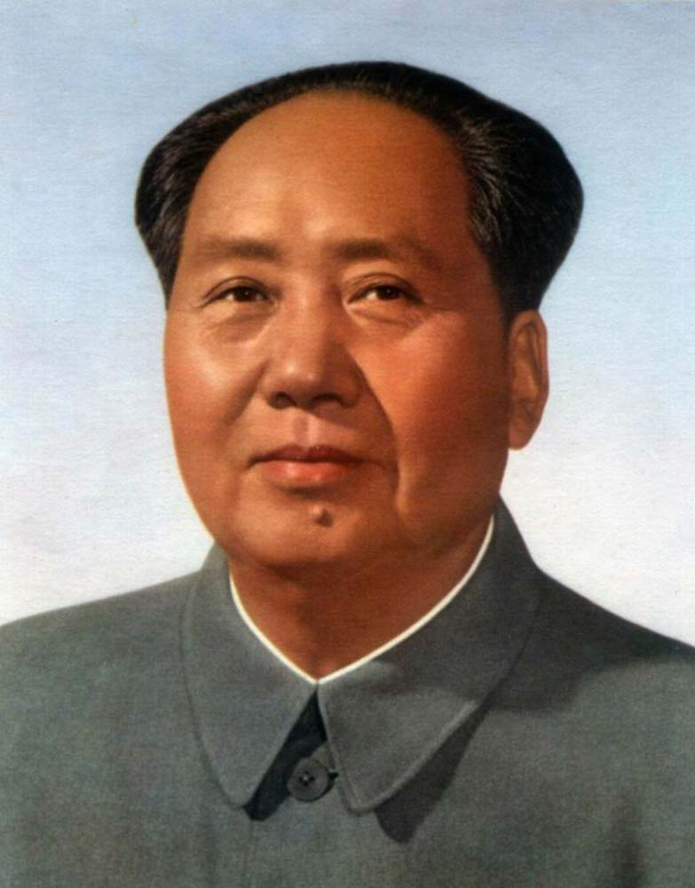

### Założenia projektu 
Analiza możliwości robota sprzątającego na przykładzie modelu Roborock S50. Ostateczny cel: autonomiczny robot do dostaw krótkodystansowych 
Uczynienie przewodniczącego Mao dumnym

#### Obiekt badań
Na potrzeby projektu zakupiony został robot w stanie "uszkodzony, błąd 13". Przy początkowych testach wykazał błąd 18, przez co zdecydowaliśmy się kompletnie go rozmontować i wyczyścić. Po czyszczeniu błąd 18 więcej się nie pojawił. Przy testach robot poprawnie znajdował stację dokującą jednak regularnie pojawiał się błąd 13. Z tego powodu zdecydowaliśmy się przylutować do styków kable ładujące, w wyniku tego wykazaliśmy że błąd wynika z uszkodzonej stacji ładującej

### Ruch w praktyce
Kontrola ruchu robota opiera się na funkcji Uart_test, prawdopodobnie pozostawionej w systemie jako funkcja testowa podzespołów.