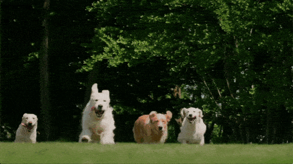

# SAM 3: Segment Anything with Concepts

Meta Superintelligence Labs

[Nicolas Carion](https://www.nicolascarion.com/)\*,
[Laura Gustafson](https://scholar.google.com/citations?user=c8IpF9gAAAAJ&hl=en)\*,
[Yuan-Ting Hu](https://scholar.google.com/citations?user=E8DVVYQAAAAJ&hl=en)\*,
[Shoubhik Debnath](https://scholar.google.com/citations?user=fb6FOfsAAAAJ&hl=en)\*,
[Ronghang Hu](https://ronghanghu.com/)\*,
[Didac Suris](https://www.didacsuris.com/)\*,
[Chaitanya Ryali](https://scholar.google.com/citations?user=4LWx24UAAAAJ&hl=en)\*,
[Kalyan Vasudev Alwala](https://scholar.google.co.in/citations?user=m34oaWEAAAAJ&hl=en)\*,
[Haitham Khedr](https://hkhedr.com/)\*, Andrew Huang,
[Jie Lei](https://jayleicn.github.io/),
[Tengyu Ma](https://scholar.google.com/citations?user=VeTSl0wAAAAJ&hl=en),
[Baishan Guo](https://scholar.google.com/citations?user=BC5wDu8AAAAJ&hl=en),
Arpit Kalla, [Markus Marks](https://damaggu.github.io/),
[Joseph Greer](https://scholar.google.com/citations?user=guL96CkAAAAJ&hl=en),
Meng Wang, [Peize Sun](https://peizesun.github.io/),
[Roman Rädle](https://scholar.google.com/citations?user=Tpt57v0AAAAJ&hl=en),
[Triantafyllos Afouras](https://www.robots.ox.ac.uk/~afourast/),
[Effrosyni Mavroudi](https://scholar.google.com/citations?user=vYRzGGEAAAAJ&hl=en),
[Katherine Xu](https://k8xu.github.io/)°,
[Tsung-Han Wu](https://patrickthwu.com/)°,
[Yu Zhou](https://yu-bryan-zhou.github.io/)°,
[Liliane Momeni](https://scholar.google.com/citations?user=Lb-KgVYAAAAJ&hl=en)°,
[Rishi Hazra](https://rishihazra.github.io/)°,
[Shuangrui Ding](https://mark12ding.github.io/)°,
[Sagar Vaze](https://sgvaze.github.io/)°,
[Francois Porcher](https://scholar.google.com/citations?user=LgHZ8hUAAAAJ&hl=en)°,
[Feng Li](https://fengli-ust.github.io/)°,
[Siyuan Li](https://siyuanliii.github.io/)°,
[Aishwarya Kamath](https://ashkamath.github.io/)°,
[Ho Kei Cheng](https://hkchengrex.com/)°,
[Piotr Dollar](https://pdollar.github.io/)†,
[Nikhila Ravi](https://nikhilaravi.com/)†,
[Kate Saenko](https://ai.bu.edu/ksaenko.html)†,
[Pengchuan Zhang](https://pzzhang.github.io/pzzhang/)†,
[Christoph Feichtenhofer](https://feichtenhofer.github.io/)†

\* core contributor, ° intern, † project lead, order is random within groups

[[`Paper`](https://ai.meta.com/research/publications/sam-3-segment-anything-with-concepts/)]
[[`Project`](https://ai.meta.com/sam3)]
[[`Demo`](https://segment-anything.com/)]
[[`Blog`](https://ai.meta.com/blog/segment-anything-model-3/)]
[[`BibTeX`](#citing-sam-3)]

 SAM 3 is a unified foundation model for promptable segmentation in images and videos. It can detect, segment, and track objects using text or visual prompts such as points, boxes, and masks. Compared to its predecessor [SAM 2](https://github.com/facebookresearch/sam2), SAM 3 introduces the ability to exhaustively segment all instances of an open-vocabulary concept specified by a short text phrase or exemplars. Unlike prior work, SAM 3 can handle a vastly larger set of open-vocabulary prompts. It achieves 75-80% of human performance on our new [SA-CO benchmark](https://github.com/facebookresearch/sam3?tab=readme-ov-file#sa-co-dataset) which contains 270K unique concepts, over 50 times more than existing benchmarks.

This breakthrough is driven by an innovative data engine that has automatically annotated over 4 million unique concepts, creating the largest high-quality open-vocabulary segmentation dataset to date. In addition, SAM 3 introduces a new model architecture featuring a presence token that improves discrimination between closely related text prompts (e.g., “a player in white” vs. “a player in red”), as well as a decoupled detector–tracker design that minimizes task interference and scales efficiently with data.

<p align="center">
  
  
</p>

## Latest updates

**03/27/2026 -- SAM 3.1 Object Multiplex is released. It introduces a shared-memory approach for joint multi-object tracking that is significantly faster without sacrificing accuracy.**

- A new suite of improved model checkpoints (denoted as **SAM 3.1**) are released on [Hugging Face](https://huggingface.co/facebook/sam3.1). See [`RELEASE_SAM3p1.md`](RELEASE_SAM3p1.md) for full details.
  * To use the new SAM 3.1 checkpoints, you need the latest model code from this repo. If you have installed an earlier version of this repo, pull the latest code from this repo (with `git pull`), and then reinstall the repo following [Installation](#installation) below.

## Installation

### Prerequisites

- Python 3.12 or higher
- PyTorch 2.7 or higher
- CUDA-compatible GPU with CUDA 12.6 or higher

For image inference and SAM 3 base single-process video inference on Apple Silicon, use an
MPS-enabled PyTorch build instead of CUDA. Training and the CUDA-only optional
acceleration packages are not covered by the MPS inference path. The SAM 3.1
multiplex predictor remains CUDA-specific.

1. **Create a new Conda environment:**

```bash
conda create -n sam3 python=3.12
conda deactivate
conda activate sam3
```

2. **Install PyTorch with CUDA support:**

```bash
pip install torch==2.10.0 torchvision --index-url https://download.pytorch.org/whl/cu128
```

On Apple Silicon, install PyTorch and torchvision for macOS instead:

```bash
pip install torch torchvision
python -c "import torch; print(torch.backends.mps.is_available())"
```

The model builders choose CUDA, MPS, or CPU automatically. You can also pass
`device="mps"` to `build_sam3_image_model` or
`build_sam3_predictor(version="sam3", device="mps")`.

3. **Clone the repository and install the package:**

```bash
git clone https://github.com/facebookresearch/sam3.git
cd sam3
pip install -e .
```

4. **Install additional dependencies for example notebooks or development:**

```bash
# For running example notebooks
pip install -e ".[notebooks]"

# For development
pip install -e ".[train,dev]"
```

5. **Optional dependencies for faster inference**
```bash
pip install einops ninja && pip install flash-attn-3 --no-deps --index-url https://download.pytorch.org/whl/cu128
pip install git+https://github.com/ronghanghu/cc_torch.git
```

## Getting Started

⚠️ Before using SAM 3, please request access to the checkpoints on the SAM 3
Hugging Face [repo](https://huggingface.co/facebook/sam3). Once accepted, you
need to be authenticated to download the checkpoints. You can do this by running
the following [steps](https://huggingface.co/docs/huggingface_hub/en/quick-start#authentication)
(e.g. `hf auth login` after generating an access token.)

### Basic Usage

```python
import torch
#################################### For Image ####################################
from PIL import Image
from sam3.model_builder import build_sam3_image_model
from sam3.model.sam3_image_processor import Sam3Processor
# Load the model
model = build_sam3_image_model()
processor = Sam3Processor(model)
# Load an image
image = Image.open("<YOUR_IMAGE_PATH.jpg>")
inference_state = processor.set_image(image)
# Prompt the model with text
output = processor.set_text_prompt(state=inference_state, prompt="<YOUR_TEXT_PROMPT>")

# Get the masks, bounding boxes, and scores
masks, boxes, scores = output["masks"], output["boxes"], output["scores"]

#################################### For Video ####################################

from sam3.model_builder import build_sam3_video_predictor

video_predictor = build_sam3_video_predictor()
video_path = "<YOUR_VIDEO_PATH>" # a JPEG folder or an MP4 video file
# Start a session
response = video_predictor.handle_request(
    request=dict(
        type="start_session",
        resource_path=video_path,
    )
)
response = video_predictor.handle_request(
    request=dict(
        type="add_prompt",
        session_id=response["session_id"],
        frame_index=0, # Arbitrary frame index
        text="<YOUR_TEXT_PROMPT>",
    )
)
output = response["outputs"]
```

### Export a video with mask overlays

The CLI uses the base SAM 3 video predictor to segment a text prompt and writes
an H.264 MP4 with semitransparent masks. It accepts an MP4 (or another supported
video file) or a folder of image frames. FFmpeg must be installed; audio from a
video input is included by default. Video files are decoded one frame at a time
to avoid loading the whole clip into memory. On MPS, decoded frames and tracking
state are offloaded to CPU by default; the `--no-offload-video-to-cpu` and
`--no-offload-state-to-cpu` options override this if memory allows.

```bash
python scripts/export_video_overlay.py input.mp4 output.mp4 \
  --text "a dog" --device mps --alpha 0.45

# A folder of numbered frames has no source FPS, so choose one if needed:
python scripts/export_video_overlay.py frames/ output.mp4 \
  --text "a dog" --fps 24

# For MPS driver memory growth, restart inference every three frames:
python scripts/export_video_overlay.py input.mp4 output.mp4 \
  --text "a dog" --device mps --restart-every 3
```

Use `--checkpoint /path/to/sam3.pt` for a local checkpoint, or authenticate to
Hugging Face so the predictor can download it. Use `--memory-report` to see
process and MPS memory after model loading, session startup, and prompting,
then for the first 10 frames and every 30 frames. Run `--help` for all options.
`--restart-every` loads the model in a fresh process for each segment to bound
MPS driver memory. Text detection and tracking restart at each segment boundary,
so masks may change there and processing takes longer due to repeated model loads.

### Export image-mask pairs for segmentation training

Use `--image-mode` to label sampled video frames independently with the SAM 3
image model. The output folder contains matching `images/000000.jpg` and
`masks/000000.png` files, overlay previews in `overlays/`, a `metadata.jsonl`
record for each frame, and `dataset.json` with the export settings. Masks are
single-channel PNGs: 255 for the union of detected regions and 0 for background.
Frames with no detected region have an all-zero mask and remain in the dataset.
The image mode does not use video tracking and does not require FFmpeg.

Add `--drop-empty` to delete exported image copies with **zero masks across all
classes**, together with their mask files, per-class masks, and overlay previews.
They are omitted from metadata and training archives; the input images and
videos stay intact. The check uses detections remaining after `--confidence`
filtering. An image is kept if any class has a mask. `dataset.json` reports
extracted, retained, and discarded counts. If every image is discarded, export
finishes with an empty dataset and skips the training archive. Sampling and
`--max-samples` still count frames selected for inference, before discarding.

Image mode also accepts a **folder of videos**, combining all sampled frames
into one dataset. It reads supported video files directly in that folder
(`.mp4`, `.mov`, `.avi`, `.mkv`, `.webm`) in filename order. Sampling with
`--sample-every N` restarts at frame 0 for each clip; `--max-samples N` limits
the total selected frames across all clips. Exported filenames are unique across
videos. Each metadata row records `source`, `source_frame_index`, `source_fps`,
and a timestamp relative to that clip; `dataset.json` lists the source videos
and their frame rates. Subfolders are not scanned. Keep images and videos in
separate input folders; mixed media folders are rejected. Video folders require
`--image-mode`.

```bash
python scripts/export_video_overlay.py /path/to/videos street_dataset \
  --image-mode --text "sidewalk" --text "person" --device mps \
  --sample-every 30 --export-format yolo --no-overlays
```

Add `--export-format yolo`, `coco`, or `ndjson` to also create an upload-ready
`training/dataset.zip`. These formats preserve individual SAM instances;
the original PNG masks still contain their union. The default
`--export-task segment` writes instance polygons. Use `--export-task detect`
for bounding boxes instead. A single text prompt becomes class 0 (COCO category 1),
or set `--class-name` to give that class a different name. Images without objects
are included with empty annotations.

```bash
python scripts/export_video_overlay.py input.mp4 sidewalk_yolo \
  --image-mode --text "sidewalk" --device mps --sample-every 30 \
  --export-format yolo --export-task segment --no-overlays

# Bounding boxes in Ultralytics NDJSON, in ZIPs of up to 1,000 images / 500 MB:
python scripts/export_video_overlay.py input.mp4 obstacle_ndjson \
  --image-mode --text "obstacle" --device mps --sample-every 30 \
  --export-format ndjson --export-task detect \
  --chunk-size 1000 --chunk-max-mb 500 --no-overlays

# Label three classes together; IDs are 0=sidewalk, 1=person, 2=car:
python scripts/export_video_overlay.py input.mp4 street_dataset \
  --image-mode --text "sidewalk" --text "person" --text "car" \
  --device mps --sample-every 30 --export-format ndjson --no-overlays
```

Repeat `--text` once for each class. Each image is encoded once, then SAM grounds
each prompt independently against the cached image features. All prompts are
encoded once per worker before the text encoder is released. Class IDs follow
prompt order and remain the same across every image and ZIP chunk. The default
class names are the prompts; to rename them, repeat `--class-name` once per
`--text`, in the same order. For example, `--text "a paved sidewalk" --text
"a person" --class-name sidewalk --class-name person`. Metadata records class
IDs on instances, per-class counts, and the full class list in `dataset.json`.
For multiple classes, `masks/class-000/`, `masks/class-001/`, etc. hold separate
binary masks, while `masks/000000.png` remains the union across classes. Overlay
previews use different colors for each class. Cross-class overlaps are preserved;
use distinct prompts and review annotations. Multiple prompts require image mode.

Use `--batching high|medium|low|none` to choose how many class prompts run in
each grounding call against the same cached image. `none` is the default.

| Level | Prompts per call | Example with 8 classes |
| --- | --- | --- |
| `high` | 100% of classes | 8 |
| `medium` | 50% of classes, rounded up | 4 |
| `low` | 25% of classes, rounded up | 2 |
| `none` | One class at a time | 1 |

Every class is processed at every level. The last group may be smaller, and
groups always have at least one prompt. With three classes, `high` uses three,
`medium` two, and `low`/`none` one prompt per call. Batched groups use one native
SAM grounding call, rather than a sequence of individual prompt calls. Higher
levels can improve throughput at the cost of more peak GPU memory; the setting
controls prompt group size, not a percentage of GPU utilization. This does not
batch different images or change `--restart-every`. The selected level and
resolved group size are recorded in `dataset.json`.

For example, add `--batching high` to the multi-class command above to ground
sidewalk, person, and car together on each image.

YOLO archives contain `data.yaml`, `images/train|val/`, and matching
`labels/train|val/*.txt`. COCO archives contain images and
`annotations/instances_train.json` / `instances_val.json` with pixel coordinates.
NDJSON archives contain `dataset.ndjson` and the referenced local images, plus
matching YOLO `data.yaml` and `.txt` companion labels. **Upload the ZIP to
Platform.** Its documented format detection prioritizes the YOLO YAML, so local
images and labels import together without cloud image downloads. The NDJSON
file is preserved for the local Ultralytics converter, using `path: "."` after
extracting the ZIP. The old NDJSON export omitted image URLs and had no companion
labels; its local paths could not be downloaded by the cloud NDJSON importer,
causing imports to fail. `training/manifest.json` reports the selected export
format and the format used for Platform import.

For a **standalone NDJSON cloud upload**, images must already be available over
HTTP(S). Set `--ndjson-image-url-base https://example.org/my-dataset/` with the
images hosted at `images/train/000000.jpg`, `images/val/000030.jpg`, etc. The
exporter writes an explicit URL for every image and omits the local `path`
override and YOLO companions. A `.ndjson` file is saved alongside each ZIP;
upload that file when the URLs are reachable by Platform. This option does not
host or upload the images. See the
[Ultralytics dataset upload documentation](https://docs.ultralytics.com/platform/data/datasets/)
and [NDJSON specification](https://docs.ultralytics.com/datasets/detect/#ultralytics-ndjson-format).

To rebuild a failed export from saved instance annotations **without rerunning
SAM**, use a new output folder:

```bash
python scripts/training_export.py existing_dataset fixed_ndjson \
  --export-format ndjson
```

This reads `dataset.json`, `metadata.jsonl`, and the training JPEGs, preserves
saved classes, task, and split settings, and creates new archives. Old exports
and annotation files stay intact. The same chunking and large-image controls
are available. Datasets exported only as union PNG masks need another labeling
run with a training format to retain individual instances.

`--val-fraction` defaults to 0.2: the last selected frames are reserved for
validation, with at least one image left for training. Set it to 0 to export
only training images. A one-image dataset cannot have both splits. Splits are
assigned before chunking, so an image appears once and keeps its split across
all chunks. For video training, use independent recordings for final validation
to avoid evaluating on near-identical frames from the same clip.

`--chunk-size N` limits images per ZIP, and `--chunk-max-mb MB` limits ZIP bytes
using decimal MB, including annotation and archive overhead. Either or both
produce independent `training/chunk-0001.zip`, etc., each with its own complete
annotations and class definitions. All chunks must be uploaded to the same
dataset to retain the full train/validation split; a chunk can contain only one
split. `training/manifest.json` lists sizes and split counts. Size packing uses
a conservative allowance for repeated metadata, so chunks may be smaller than
the requested maximum. If one image and its annotations exceed the chunk
limit, export stops with an error. Chunking applies to training formats and
does not change `--restart-every` inference batches. ZIPs store the already
compressed JPEGs without another compression pass.

For any selected source image or exported training JPEG **50 MB or larger**,
the parent process alerts you and asks to **continue**, **compress**, or
**abort** before loading SAM weights or starting labeling workers. Compression
reduces JPEG quality on exported copies until they are below 50 MB, preserving
dimensions and source files. If that cannot meet the limit, export stops;
it does not resize images automatically. For unattended runs, explicitly choose
`--large-image-action continue|compress|abort`. The default `ask` stops with an
actionable error when no interactive terminal is available. Aborting at the
source check creates no output; aborting after extracting oversized video
frames leaves those extracted files for inspection.

Polygon exports follow outer mask contours. Holes are filled; disconnected
components of one instance are retained as multiple COCO polygons or joined
with a doubled bridge for YOLO/NDJSON. Review generated labels before training.

```bash
python scripts/export_video_overlay.py input.mp4 sidewalk_dataset \
  --image-mode --text "sidewalk" --device mps \
  --sample-every 30 --restart-every 3 --alpha 0.45

# Inspect a small sample before labeling the whole clip:
python scripts/export_video_overlay.py input.mp4 sidewalk_sample \
  --image-mode --text "sidewalk" --device mps \
  --sample-every 30 --max-samples 10
```

On MPS, image mode restarts a worker after every three sampled frames by default
to release driver memory. `--restart-every N` adjusts the number of images per
worker; they are processed sequentially. `--restart-every 0` keeps one model
loaded for the entire dataset. Larger intervals avoid repeated model loads,
but check memory over a longer run before disabling restarts on MPS.

For a timed run with fewer model loads and no preview encoding:

```bash
python scripts/export_video_overlay.py input.mp4 sidewalk_bench30 \
  --image-mode --text "sidewalk" --device mps \
  --sample-every 30 --max-samples 30 --restart-every 30 \
  --no-overlays --timing-report --memory-report
```

Image mode encodes each fixed text prompt once per worker and reuses its features
for subsequent images. It then releases the text encoder's weights for the
rest of that worker's run, reducing retained model memory without changing the
cached prompt. `--no-overlays` saves images, masks, and metadata without
the `overlays/` folder; metadata records `null` for the overlay path.
`--timing-report` prints model setup, per-image inference and output times, and
total export time including extraction and worker restarts.

Image mode offers three named presets:

- `--preset quality`: 1008 pixels with FP16 weights.
- `--preset fast`: 840 pixels with FP32 weights.
- `--preset full`: 1008 pixels with FP32 weights and prediction, without autocast.

Explicit `--inference-size` and `--precision` flags override the preset.
All three keep Metal matmul and fast math disabled unless explicitly enabled.
The preset and resolved settings are recorded in `dataset.json`.

```bash
python scripts/export_video_overlay.py input.mp4 sidewalk_quality \
  --image-mode --preset quality --text "sidewalk" --device mps \
  --sample-every 30 --restart-every 48 --no-overlays

python scripts/export_video_overlay.py input.mp4 sidewalk_fast \
  --image-mode --preset fast --text "sidewalk" --device mps \
  --sample-every 30 --restart-every 48 --no-overlays

python scripts/export_video_overlay.py input.mp4 sidewalk_full \
  --image-mode --preset full --text "sidewalk" --device mps \
  --sample-every 30 --restart-every 48 --no-overlays
```

These names express a speed/detail preference. The 840/FP32 configuration
achieved 95.77% mean agreement with 1008/FP32 on six frames, but has not passed
the larger validation. The 1008/FP16 configuration reached 99.97% agreement on
six frames. Review representative labels before using either for a large dataset;
agreement with SAM3 is not human-verified segmentation accuracy.

Image inference defaults to resizing each selected frame to 1008 by 1008 for
the backbone, so reducing the input video's resolution alone does not reduce
that work. Image mode supports `--inference-size 672` (or 504 or 336) to reduce
the actual backbone input and activation memory. The model's global-attention
positional frequencies are regenerated for the selected size after checkpoint
loading. Saved images and masks retain the original frame dimensions. Model
weights default to float32 without a preset, so the total memory reduction is not proportional to
the pixel count. Lower sizes may miss thin or distant regions; compare previews
with the default 1008 size before labeling your training dataset.

```bash
python scripts/export_video_overlay.py input.mp4 sidewalk_memory672 \
  --image-mode --text "sidewalk" --device mps \
  --inference-size 672 --sample-every 30 --max-samples 30 \
  --restart-every 100 --timing-report --memory-report
```

Increasing `--sample-every` reduces the number of frames labeled. Review the
overlay previews and correct labels before using them
to train a smaller model, especially for thin or distant sidewalk regions.

### Benchmark inference size and mask quality

Use the same representative frames to compare 1008, 672, 504, and 336 pixel
inference. Each size runs in a separate process with the text encoder released
after prompt caching. Keep other applications and power conditions unchanged
during the comparison.

```bash
python scripts/benchmark_image_inference.py input.mp4 sidewalk_benchmark \
  --text "sidewalk" --device mps --samples 12 \
  --max-iou-loss 0.05 --min-frame-iou 0.80
```

Frames are evenly distributed across the input; `--sample-every N` instead
selects the first requested samples at that interval. The first sample is a
warmup excluded from timing, but still used for quality. `--sizes 1008 672 504`
limits the sweep; 1008 is always included as the timing baseline.

Without human masks, **quality measures agreement with 1008-pixel SAM3**, not
actual segmentation accuracy. Supply `--reference-masks labels/` to use human
binary masks: single-channel PNGs containing 0/1 or 0/255 with original frame
dimensions. For videos, names use the zero-padded original frame index, such as
`000030.png`; for image folders, names match the source image stem.

The recommendation is the fastest measured mean frame processing time meeting all
quality limits: mean IoU and aggregate intersection-over-union must each be at
least `1 - max_iou_loss`, and every scored frame must meet `min_frame_iou`.
Both-empty frames are excluded from mean IoU so empty scenes cannot inflate
agreement; one-empty disagreements score zero. No recommendation is made when
the reference contains no foreground or no configuration meets the limits.

Results are in `report.json`, `results.csv`, and `agreement.csv`. Original-size
masks and per-size metadata remain in size folders. `comparisons/` contains
preview strips: green overlap, red extra prediction, blue missed reference.
Review these before adopting a smaller size for training labels.

Process RSS and MPS tensor/driver peaks are sampled every 100 ms including model
setup; short spikes may be missed, and the figures overlap rather than adding
up to total RAM. Optional `--max-peak-mps-gib 8` excludes configurations exceeding
that sampled MPS driver limit. Swap changes are system-wide, not attributed to
the inference worker. Ranking includes reading, preprocessing, model execution,
CPU mask transfer, PNG writes and cache cleanup. Inference-only timing is also
recorded separately; initial warmup frames and model setup are excluded from ranking.
Repeated runs with more diverse samples provide stronger evidence than a short
benchmark. Input frames are saved as JPEGs, matching the dataset exporter.

### Full MPS optimization suite

For a small Metal matmul comparison, run:

```bash
python scripts/benchmark_metal_matmul.py input.mp4 sidewalk_metal_ab \
  --text "sidewalk" --checkpoint /path/to/sam3.pt
```

This runs only four fresh workers in off/on/on/off order, using six shared
frames at 1008 pixels in FP32 and excluding two warmup frames per worker.
The worker time budget defaults to four minutes. `report.json` records timings,
mask agreement and sampled memory; each worker also records its actual MPS
environment. Use a new output folder for each comparison.
Add `--option fast-math` to test fast math with Metal matmul disabled instead.

```bash
python scripts/benchmark_image_inference.py input.mp4 sidewalk_full_suite \
  --text "sidewalk" --device mps --full-suite \
  --screen-samples 6 --samples 12 --warmup 2 --repeats 2 \
  --validation-samples 48 --max-iou-loss 0.05 --min-frame-iou 0.80 \
  --max-peak-mps-gib 8 --mps-allocator-limit-gib 8
```

The suite screens independent precision, attention, preprocessing, mask
postprocessing, cache cleanup, Metal matmul, fast math, CPU thread count, vision
MLP chunking, and resolution changes. It tests all 25 supported sizes from 336
through 1008 in steps of 28. It also retries precision modes with smaller window
attention and MLP activations, since memory failures can depend on combinations.
It then combines promising passing settings, repeats
the finalists in alternating order, and validates the leading configurations
on more frames. This is a staged search rather than the exhaustive Cartesian
product of every setting. `suite.json` records every phase and validated
exporter flags. Failed/OOM or non-finite configurations are recorded and cannot
win. A candidate must pass every repeat and the longer quality/memory check.

Precision modes are `fp32`, `amp-fp16`, `amp-bf16`, and `fp16`. Autocast modes
retain float32 weights and reuse their cast cache across frames. `fp16` stores
most weights in half precision while retaining float32 normalization and decoder
FFN layers. Text weights and their autocast cache are released after prompt
encoding. Each option remains explicit; passing on one clip does not establish
accuracy on other scenes.

Exporter image-mode controls also include `--attention chunked|sdpa`,
`--attention-chunk 64|128|256|512|1024`, `--attention-scope global|all`,
`--mlp-chunk 0|256|512|1024|2048`, `--preprocess cpu|mps`,
`--postprocess cpu|mps`, `--cache-policy auto|never|always|every-8`,
`--prefer-metal`, `--fast-math`, and `--cpu-threads N`. Here `mps` means the model
device; the CPU/CUDA exporter can still use its normal device. The environment
options are set in fresh worker processes before MPS initialization.
MLP chunking is restricted to inference on MPS and preserves per-token operations.
The suite checks raw model outputs for NaN/Inf and synchronizes stage timings.
Backbone timings include input decoding/preprocessing; grounding timings include
the detector, mask resizing, finite checks, and transfer to CPU. Peak memory
includes setup. The allocator guard limits PyTorch MPS allocations, while
framework allocations may still exceed that amount; the driver peak gate is a
separate sampled measurement. GPU batch size stays at one to retain RAM headroom.

Run the local correctness tests without additional test dependencies:

```bash
python -m unittest discover -s test -p 'test_*.py' -v
```

## Examples

The `examples` directory contains notebooks demonstrating how to use SAM3 with
various types of prompts:

- [`sam3_image_predictor_example.ipynb`](examples/sam3_image_predictor_example.ipynb)
  : Demonstrates how to prompt SAM 3 with text and visual box prompts on images.
- [`sam3_video_predictor_example.ipynb`](examples/sam3_video_predictor_example.ipynb)
  : Demonstrates how to prompt SAM 3 with text prompts on videos, and doing
  further interactive refinements with points.
- [`sam3_image_batched_inference.ipynb`](examples/sam3_image_batched_inference.ipynb)
  : Demonstrates how to run batched inference with SAM 3 on images.
- [`sam3_agent.ipynb`](examples/sam3_agent.ipynb): Demonsterates the use of SAM
  3 Agent to segment complex text prompt on images.
- [`saco_gold_silver_vis_example.ipynb`](examples/saco_gold_silver_vis_example.ipynb)
  : Shows a few examples from SA-Co image evaluation set.
- [`saco_veval_vis_example.ipynb`](examples/saco_veval_vis_example.ipynb) :
  Shows a few examples from SA-Co video evaluation set.

There are additional notebooks in the examples directory that demonstrate how to
use SAM 3 for interactive instance segmentation in images and videos (SAM 1/2
tasks), or as a tool for an MLLM, and how to run evaluations on the SA-Co
dataset.

To run the Jupyter notebook examples:

```bash
# Make sure you have the notebooks dependencies installed
pip install -e ".[notebooks]"

# Start Jupyter notebook
jupyter notebook examples/sam3_image_predictor_example.ipynb
```

## Model

SAM 3 consists of a detector and a tracker that share a vision encoder. It has 848M parameters. The
detector is a DETR-based model conditioned on text, geometry, and image
exemplars. The tracker inherits the SAM 2 transformer encoder-decoder
architecture, supporting video segmentation and interactive refinement.

## Image Results

<div align="center">
<table style="min-width: 80%; border: 2px solid #ddd; border-collapse: collapse">
  <thead>
    <tr>
      <th rowspan="3" style="border-right: 2px solid #ddd; padding: 12px 20px">Model</th>
      <th colspan="3" style="text-align: center; border-right: 2px solid #ddd; padding: 12px 20px">Instance Segmentation</th>
      <th colspan="5" style="text-align: center; padding: 12px 20px">Box Detection</th>
    </tr>
    <tr>
      <th colspan="2" style="text-align: center; border-right: 1px solid #eee; padding: 12px 20px">LVIS</th>
      <th style="text-align: center; border-right: 2px solid #ddd; padding: 12px 20px">SA-Co/Gold</th>
      <th colspan="2" style="text-align: center; border-right: 1px solid #eee; padding: 12px 20px">LVIS</th>
      <th colspan="2" style="text-align: center; border-right: 1px solid #eee; padding: 12px 20px">COCO</th>
      <th style="text-align: center; padding: 12px 20px">SA-Co/Gold</th>
    </tr>
    <tr>
      <th style="text-align: center; padding: 12px 20px">cgF1</th>
      <th style="text-align: center; border-right: 1px solid #eee; padding: 12px 20px">AP</th>
      <th style="text-align: center; border-right: 2px solid #ddd; padding: 12px 20px">cgF1</th>
      <th style="text-align: center; padding: 12px 20px">cgF1</th>
      <th style="text-align: center; border-right: 1px solid #eee; padding: 12px 20px">AP</th>
      <th style="text-align: center; padding: 12px 20px">AP</th>
      <th style="text-align: center; border-right: 1px solid #eee; padding: 12px 20px">AP<sub>o</sub>
</th>
      <th style="text-align: center; padding: 12px 20px">cgF1</th>
    </tr>
  </thead>
  <tbody>
    <tr>
      <td style="border-right: 2px solid #ddd; padding: 10px 20px">Human</td>
      <td style="text-align: center; padding: 10px 20px">-</td>
      <td style="text-align: center; border-right: 1px solid #eee; padding: 10px 20px">-</td>
      <td style="text-align: center; border-right: 2px solid #ddd; padding: 10px 20px">72.8</td>
      <td style="text-align: center; padding: 10px 20px">-</td>
      <td style="text-align: center; border-right: 1px solid #eee; padding: 10px 20px">-</td>
      <td style="text-align: center; padding: 10px 20px">-</td>
      <td style="text-align: center; border-right: 1px solid #eee; padding: 10px 20px">-</td>
      <td style="text-align: center; padding: 10px 20px">74.0</td>
    </tr>
    <tr>
      <td style="border-right: 2px solid #ddd; padding: 10px 20px">OWLv2*</td>
      <td style="text-align: center; padding: 10px 20px; color: #999">29.3</td>
      <td style="text-align: center; border-right: 1px solid #eee; padding: 10px 20px; color: #999">43.4</td>
      <td style="text-align: center; border-right: 2px solid #ddd; padding: 10px 20px">24.6</td>
      <td style="text-align: center; padding: 10px 20px; color: #999">30.2</td>
      <td style="text-align: center; border-right: 1px solid #eee; padding: 10px 20px; color: #999">45.5</td>
      <td style="text-align: center; padding: 10px 20px">46.1</td>
      <td style="text-align: center; border-right: 1px solid #eee; padding: 10px 20px">23.9</td>
      <td style="text-align: center; padding: 10px 20px">24.5</td>
    </tr>
    <tr>
      <td style="border-right: 2px solid #ddd; padding: 10px 20px">DINO-X</td>
      <td style="text-align: center; padding: 10px 20px">-</td>
      <td style="text-align: center; border-right: 1px solid #eee; padding: 10px 20px">38.5</td>
      <td style="text-align: center; border-right: 2px solid #ddd; padding: 10px 20px">21.3</td>
      <td style="text-align: center; padding: 10px 20px">-</td>
      <td style="text-align: center; border-right: 1px solid #eee; padding: 10px 20px">52.4</td>
      <td style="text-align: center; padding: 10px 20px">56.0</td>
      <td style="text-align: center; border-right: 1px solid #eee; padding: 10px 20px">-</td>
      <td style="text-align: center; padding: 10px 20px">22.5</td>
    </tr>
    <tr>
      <td style="border-right: 2px solid #ddd; padding: 10px 20px">Gemini 2.5</td>
      <td style="text-align: center; padding: 10px 20px">13.4</td>
      <td style="text-align: center; border-right: 1px solid #eee; padding: 10px 20px">-</td>
      <td style="text-align: center; border-right: 2px solid #ddd; padding: 10px 20px">13.0</td>
      <td style="text-align: center; padding: 10px 20px">16.1</td>
      <td style="text-align: center; border-right: 1px solid #eee; padding: 10px 20px">-</td>
      <td style="text-align: center; padding: 10px 20px">-</td>
      <td style="text-align: center; border-right: 1px solid #eee; padding: 10px 20px">-</td>
      <td style="text-align: center; padding: 10px 20px">14.4</td>
    </tr>
    <tr style="border-top: 2px solid #b19c9cff">
      <td style="border-right: 2px solid #ddd; padding: 10px 20px">SAM 3</td>
      <td style="text-align: center; padding: 10px 20px">37.2</td>
      <td style="text-align: center; border-right: 1px solid #eee; padding: 10px 20px">48.5</td>
      <td style="text-align: center; border-right: 2px solid #ddd; padding: 10px 20px">54.1</td>
      <td style="text-align: center; padding: 10px 20px">40.6</td>
      <td style="text-align: center; border-right: 1px solid #eee; padding: 10px 20px">53.6</td>
      <td style="text-align: center; padding: 10px 20px">56.4</td>
      <td style="text-align: center; border-right: 1px solid #eee; padding: 10px 20px">55.7</td>
      <td style="text-align: center; padding: 10px 20px">55.7</td>
    </tr>
  </tbody>
</table>

<p style="text-align: center; margin-top: 10px; font-size: 0.9em; color: #ddd;">* Partially trained on LVIS, AP<sub>o</sub> refers to COCO-O accuracy</p>

</div>

## Video Results

<div align="center">
<table style="min-width: 80%; border: 2px solid #ddd; border-collapse: collapse">
  <thead>
    <tr>
      <th rowspan="2" style="border-right: 2px solid #ddd; padding: 12px 20px">Model</th>
      <th colspan="2" style="text-align: center; border-right: 1px solid #eee; padding: 12px 20px">SA-V test</th>
      <th colspan="2" style="text-align: center; border-right: 1px solid #eee; padding: 12px 20px">YT-Temporal-1B test</th>
      <th colspan="2" style="text-align: center; border-right: 1px solid #eee; padding: 12px 20px">SmartGlasses test</th>
      <th style="text-align: center; border-right: 1px solid #eee; padding: 12px 20px">LVVIS test</th>
      <th style="text-align: center; padding: 12px 20px">BURST test</th>
    </tr>
    <tr>
      <th style="text-align: center; padding: 12px 20px">cgF1</th>
      <th style="text-align: center; border-right: 1px solid #eee; padding: 12px 20px">pHOTA</th>
      <th style="text-align: center; padding: 12px 20px">cgF1</th>
      <th style="text-align: center; border-right: 1px solid #eee; padding: 12px 20px">pHOTA</th>
      <th style="text-align: center; padding: 12px 20px">cgF1</th>
      <th style="text-align: center; border-right: 1px solid #eee; padding: 12px 20px">pHOTA</th>
      <th style="text-align: center; border-right: 1px solid #eee; padding: 12px 20px">mAP</th>
      <th style="text-align: center; padding: 12px 20px">HOTA</th>
    </tr>
  </thead>
  <tbody>
    <tr>
      <td style="border-right: 2px solid #ddd; padding: 10px 20px">Human</td>
      <td style="text-align: center; padding: 10px 20px">53.1</td>
      <td style="text-align: center; border-right: 1px solid #eee; padding: 10px 20px">70.5</td>
      <td style="text-align: center; padding: 10px 20px">71.2</td>
      <td style="text-align: center; border-right: 1px solid #eee; padding: 10px 20px">78.4</td>
      <td style="text-align: center; padding: 10px 20px">58.5</td>
      <td style="text-align: center; border-right: 1px solid #eee; padding: 10px 20px">72.3</td>
      <td style="text-align: center; border-right: 1px solid #eee; padding: 10px 20px">-</td>
      <td style="text-align: center; padding: 10px 20px">-</td>
    </tr>
    <tr style="border-top: 2px solid #b19c9cff">
      <td style="border-right: 2px solid #ddd; padding: 10px 20px">SAM 3</td>
      <td style="text-align: center; padding: 10px 20px">30.3</td>
      <td style="text-align: center; border-right: 1px solid #eee; padding: 10px 20px">58.0</td>
      <td style="text-align: center; padding: 10px 20px">50.8</td>
      <td style="text-align: center; border-right: 1px solid #eee; padding: 10px 20px">69.9</td>
      <td style="text-align: center; padding: 10px 20px">36.4</td>
      <td style="text-align: center; border-right: 1px solid #eee; padding: 10px 20px">63.6</td>
      <td style="text-align: center; border-right: 1px solid #eee; padding: 10px 20px">36.3</td>
      <td style="text-align: center; padding: 10px 20px">44.5</td>
    </tr>
  </tbody>
</table>
</div>

## SA-Co Dataset

We release 2 image benchmarks, [SA-Co/Gold](scripts/eval/gold/README.md) and
[SA-Co/Silver](scripts/eval/silver/README.md), and a video benchmark
[SA-Co/VEval](scripts/eval/veval/README.md). The datasets contain images (or videos) with annotated noun phrases. Each image/video and noun phrase pair is annotated with instance masks and unique IDs of each object matching the phrase. Phrases that have no matching objects (negative prompts) have no masks, shown in red font in the figure. See the linked READMEs for more details on how to download and run evaluations on the datasets.

* HuggingFace host: [SA-Co/Gold](https://huggingface.co/datasets/facebook/SACo-Gold), [SA-Co/Silver](https://huggingface.co/datasets/facebook/SACo-Silver) and [SA-Co/VEval](https://huggingface.co/datasets/facebook/SACo-VEval)
* Roboflow host: [SA-Co/Gold](https://universe.roboflow.com/sa-co-gold), [SA-Co/Silver](https://universe.roboflow.com/sa-co-silver) and [SA-Co/VEval](https://universe.roboflow.com/sa-co-veval)


## Development

To set up the development environment:

```bash
pip install -e ".[dev,train]"
```

To format the code:

```bash
ufmt format .
```

## Contributing

See [contributing](CONTRIBUTING.md) and the
[code of conduct](CODE_OF_CONDUCT.md).

## License

This project is licensed under the SAM License - see the [LICENSE](LICENSE) file
for details.

## Acknowledgements

We would like to thank the following people for their contributions to the SAM 3 project: Alex He, Alexander Kirillov,
Alyssa Newcomb, Ana Paula Kirschner Mofarrej, Andrea Madotto, Andrew Westbury, Ashley Gabriel, Azita Shokpour,
Ben Samples, Bernie Huang, Carleigh Wood, Ching-Feng Yeh, Christian Puhrsch, Claudette Ward, Daniel Bolya,
Daniel Li, Facundo Figueroa, Fazila Vhora, George Orlin, Hanzi Mao, Helen Klein, Hu Xu, Ida Cheng, Jake Kinney,
Jiale Zhi, Jo Sampaio, Joel Schlosser, Justin Johnson, Kai Brown, Karen Bergan, Karla Martucci, Kenny Lehmann,
Maddie Mintz, Mallika Malhotra, Matt Ward, Michelle Chan, Michelle Restrepo, Miranda Hartley, Muhammad Maaz,
Nisha Deo, Peter Park, Phillip Thomas, Raghu Nayani, Rene Martinez Doehner, Robbie Adkins, Ross Girshik, Sasha
Mitts, Shashank Jain, Spencer Whitehead, Ty Toledano, Valentin Gabeur, Vincent Cho, Vivian Lee, William Ngan,
Xuehai He, Yael Yungster, Ziqi Pang, Ziyi Dou, Zoe Quake.

## Citing SAM 3

If you use SAM 3 or the SA-Co dataset in your research, please use the following BibTeX entry.

```bibtex
@misc{carion2025sam3segmentconcepts,
      title={SAM 3: Segment Anything with Concepts},
      author={Nicolas Carion and Laura Gustafson and Yuan-Ting Hu and Shoubhik Debnath and Ronghang Hu and Didac Suris and Chaitanya Ryali and Kalyan Vasudev Alwala and Haitham Khedr and Andrew Huang and Jie Lei and Tengyu Ma and Baishan Guo and Arpit Kalla and Markus Marks and Joseph Greer and Meng Wang and Peize Sun and Roman Rädle and Triantafyllos Afouras and Effrosyni Mavroudi and Katherine Xu and Tsung-Han Wu and Yu Zhou and Liliane Momeni and Rishi Hazra and Shuangrui Ding and Sagar Vaze and Francois Porcher and Feng Li and Siyuan Li and Aishwarya Kamath and Ho Kei Cheng and Piotr Dollár and Nikhila Ravi and Kate Saenko and Pengchuan Zhang and Christoph Feichtenhofer},
      year={2025},
      eprint={2511.16719},
      archivePrefix={arXiv},
      primaryClass={cs.CV},
      url={https://arxiv.org/abs/2511.16719},
}
```
